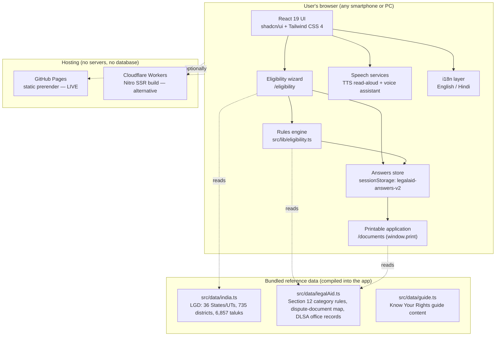
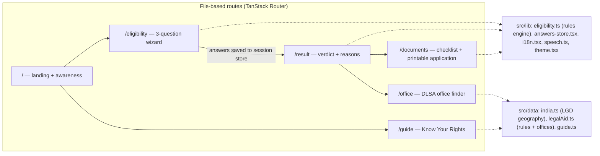
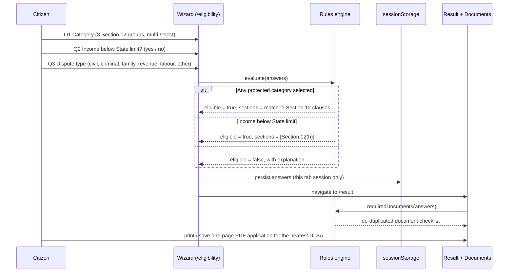

# LegalAid India — Technical Design Document

**Project:** LegalAid India — Free Legal Aid Eligibility Checker
**Repository:** https://github.com/vishwajeetsah/legalaid-mp
**Live application:** https://vishwajeetsah.github.io/legalaid-mp/
**Author:** Vishwajeet Sah
**Last updated:** 27 October 2026

---

## 1. Purpose and scope

LegalAid India helps citizens anywhere in India check whether they *may* be
eligible for free legal aid under **Section 12 of the Legal Services
Authorities Act, 1987**, and prepares a one-page printable application for the
nearest District Legal Services Authority (DLSA).

Design principles, in priority order:

1. **Eligibility first.** Three questions (category, income, dispute) are asked
   before any location or personal detail. A user who is not eligible learns
   so immediately, without filling a long form.
2. **Minimum data.** Only the particulars a DLSA officer needs to register an
   application are collected — and they never leave the user's browser.
3. **Low-literacy first.** Bilingual English/Hindi UI, text-to-speech
   read-aloud, a voice assistant, and plain-language content throughout.
4. **Indicative, never decisive.** The tool is a self-assessment aid. Final
   determination of eligibility rests with the competent Legal Services
   Authority; this disclaimer is displayed wherever a verdict is shown.

Out of scope: case filing, lawyer allocation, application submission to any
authority, and storage of applicant data. Those functions belong to the Legal
Services Authorities themselves.

## 2. System architecture

The application is a **static-first web app with no backend**. All logic —
including the statutory rules engine — runs in the browser. The production
site is prerendered to static HTML and hosted on GitHub Pages; an SSR build
targeting Cloudflare Workers exists as an alternative deployment of the same
codebase.

### 2.1 Component view

## 3. Request and data flow

## 4. The rules engine (`src/lib/eligibility.ts`)

The engine is a pure, side-effect-free module — the same code that renders the
verdict is exercised by the automated tests.

**Inputs** (`Answers`): `categories[]` (Section 12 category ids),
`incomeUnderCap` (boolean / null), `dispute` (dispute-type id), plus the
location and applicant particulars used only for display and printing.

**Decision order:**

1. Match selected categories against `RULES.categories`
   (`src/data/legalAid.ts`). **Any match → eligible**, with the matched
   statutory sections and bilingual reasons. Income is irrelevant for these
   categories, exactly as the Act provides.
2. Otherwise, `incomeUnderCap === true` → **eligible under Section 12(h)**
   (the income ceiling is set by each State Government, which is why the app
   asks a yes/no question instead of applying one national figure).
3. Otherwise → **not eligible**, with a bilingual explanation.

**Statutory mapping** (as encoded in `RULES.categories`):

| Category id | Group | Section | Category document |
|---|---|---|---|
| `scst` | Member of a Scheduled Caste / Scheduled Tribe | 12(a) | Caste certificate |
| `trafficking` | Victim of trafficking in human beings or begar | 12(b) | FIR / case papers |
| `woman` | A woman | 12(c) | Identity proof |
| `child` | A child | 12(c) | Age proof |
| `disability` | Person with disability / mental illness | 12(d) | Disability certificate |
| `disaster` | Victim of mass disaster, ethnic violence, caste atrocity, flood, drought, earthquake or industrial disaster | 12(e) | Dispute papers |
| `workman` | An industrial workman | 12(f) | Employment proof |
| `custody` | A person in custody | 12(g) | Custody papers |
| *(none)* | Any other person below the State income limit | 12(h) | Income proof |

**Document checklist** (`requiredDocuments`): identity proof and a photograph
are always required; each matched category adds its document; applicants with
no category match add income proof; the dispute type adds its document
(civil → property papers, criminal → FIR, family → marriage proof,
revenue → revenue records, labour → employment proof, other/unknown →
generic dispute papers). The list is de-duplicated.

## 5. Data model and reference data

| Dataset | Location | Content | Source |
|---|---|---|---|
| Geography | `src/data/india.ts` | 36 States/UTs, 735 districts, 6,857 taluks with LGD codes | Local Government Directory (LGD), Ministry of Panchayati Raj |
| Rules | `src/data/legalAid.ts` | Section 12 category rules (bilingual labels, reasons, documents), dispute → document map | Legal Services Authorities Act, 1987; NALSA guidance |
| Offices | `src/data/legalAid.ts` | Detailed records for Sagar district (DLSA Sagar + TLSCs at Khurai, Bina, Banda, Deori, Rahatgarh); elsewhere a standard fallback — the district's DLSA at the District & Sessions Court premises | DLSA Sagar |
| Guide content | `src/data/guide.ts` | Know Your Rights: entitlement, scope of free aid, post-application process, pre-arrest assistance | NALSA LSMS public pages |

**Known data gap:** the LGD snapshot predates some recent district creations
(e.g. Madhya Pradesh lists 52 of its current 55 districts — Maihar, Mauganj
and Pandhurna are missing). The remediation path is a dataset patch from
official LGD codes; see §8.

## 6. Privacy and security design

- **No backend, no accounts, no analytics on applicants.** There is no server
  to breach and no database of vulnerable applicants to protect.
- Answers exist only in the tab's `sessionStorage`
  (`legalaid-answers-v2`) and are discarded when the session ends. The
  printable application is generated client-side via the browser's print
  pipeline.
- The site is served over HTTPS by the static host. No cookies are set by the
  application.
- Content integrity: eligibility content is compiled into the application
  bundle from `src/data`, so the rules a user sees are exactly the rules in
  this repository, reviewable by anyone.

## 7. Internationalisation and accessibility

- Full bilingual UI (English / हिन्दी) via `src/lib/i18n.tsx`; all verdict
  reasons in the rules data are bilingual by construction (and the tests
  assert that no reason ships in one language only).
- Text-to-speech read-aloud on content pages and a voice assistant
  (`src/lib/speech.ts`) for low-literacy users.
- Responsive, mobile-first layout; dark/light themes; shadcn/ui accessible
  primitives.

## 8. Deployment

| Target | Command | Output |
|---|---|---|
| GitHub Pages (**live**) | `GH_PAGES=true bun run build` | Static prerender under base `/legalaid-mp/`, published to the `gh-pages` branch |
| Cloudflare Workers (alternative) | `bun run build` | Nitro `cloudflare-module` SSR bundle |
| Local development | `bun run dev` | Vite dev server on port 8080 |

Environment variables are build-time only and are documented in the README
(`GH_PAGES`, `VITE_ROUTER_BASEPATH`, optional `VITE_*`). No secrets exist in
any deployment.

## 9. Testing strategy

- **Rules-engine tests** (`tests/eligibility.test.ts`, Bun's test runner):
  data-driven from `tests/sample-data/eligibility-cases.json` — 10 sample
  cases covering every Section 12 clause, the income-only path, the
  not-eligible path, multi-category merging, document de-duplication and the
  unknown-dispute fallback — plus invariant tests (category beats income,
  unanswered income never qualifies, unknown category ids never qualify).
  Run with `bun test`.
- **Manual verification:** every release is checked against the live site —
  all five routes, both languages, the full wizard flow, and the printed
  application's layout.

## 10. Limitations and future work

1. Patch the LGD dataset for post-2022 districts (Maihar, Mauganj, Pandhurna
   and equivalents in other States).
2. Expand detailed DLSA/TLSC office records State by State beyond Sagar,
   in partnership with the respective Legal Services Authorities.
3. Add further Indian languages on the same bilingual data model.
4. Assisted mode for Para Legal Volunteers and Common Service Centres to run
   the checker on behalf of applicants at legal aid camps.
